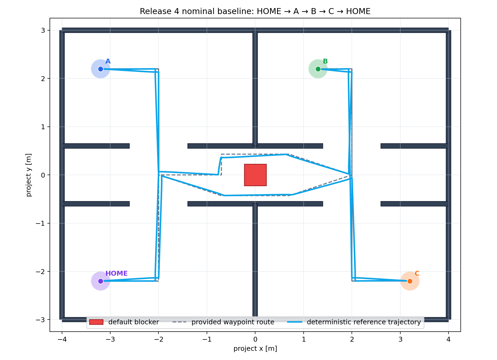

# Baseline Validation Guide

Use this guide before changing any starter code. A passing full baseline proves
that the world, robot dimensions, encoder model, LiDAR frame,
waypoints, controller, and evaluation logger work together on your computer.

## 1. Confirm the release and run offline checks

Verify that `VERSION` contains `4.0.0`, then run from the project root:

```bash
python3 tools/validate_project.py
python3 -m unittest discover -s tests -v
python3 tools/simulate_baseline.py
```

The simulator must report `"passed": true`, 23/23 route waypoints, 4/4 ordered
goals, no collision, and no blocked state. It is a deterministic consistency
test, not a substitute for Webots.

## 2. Run the untouched nominal Webots mission

Open `worlds/cmpe185_indoor_delivery.wbt` in Webots R2025a. Reset, leave the
blocker at its default center position, and do not press an evaluation key.
Run until the robot returns HOME and stops.

Expected sequence:

1. HOME `(-3.2, -2.2)`
2. left doorway and goal A `(-3.2, 2.2)`
3. upper detour around the center blocker, using `y = +0.43`
4. goal B `(1.3, 2.2)`
5. right corridor and goal C `(3.2, -2.2)`
6. lower detour around the blocker, using `y = -0.43`
7. HOME and stop

The robot should rotate in place before large corners, slow near each waypoint,
and resume forward motion. It must not scrape a wall or remain indefinitely in
`emergency_turn`. The provided safety layer may briefly slow or recover, but a
nominal run normally stays in `clear`/`slowdown`.

## 3. Reference trajectory and timing

`reference/expected_baseline_route.png` shows the required route. The supplied
controller-in-loop reference has these exact values:



| Event | Reference time | Active waypoint at event |
|---|---:|---:|
| Reach A | 91.1 s | 4 |
| Clear upper-left return | 147.5 s | 7 |
| Clear upper center detour | 203.8 s | 10 |
| Reach B | 265.7 s | 12 |
| Reach C | 357.4 s | 15 |
| Clear lower center detour | 460.8 s | 20 |
| Ground truth reaches HOME | 528.4 s | 22 |
| Controller completes 23/23 | 531.9 s | 23 |

Webots contact dynamics can shift these times. Use them as landmarks, not as
hard deadlines. A typical complete nominal run should take roughly 8.5–10.5
minutes at normal real-time speed. At 60 seconds the robot should be near or
beyond waypoint 3; around 120 seconds it should have visited A and be returning
toward the left doorway.

Reference totals are 33.37 m path length, 0.074 m final HOME error, 0 collision
episodes, and 0.084 m minimum body clearance. The zero reference odometry error
comes from the deterministic plant using the configured calibrated drive model;
a Webots run will show small nonzero drift and students should analyze it.

## 4. Check the completed log

Stop the simulation after completion and run:

```bash
python3 tools/check_run_health.py results/run_YYYYMMDD_HHMMSS.csv --require-complete
python3 tools/analyze_run.py results/run_YYYYMMDD_HHMMSS.csv
```

The health checker must report `PASS`. The full gate requires:

- `maximum_active_waypoint >= 23`
- `mission_complete_reported = True`
- `goals_reached_ground_truth = 4`
- `collision_episodes = 0`
- final ground-truth position within `0.20 m` of HOME
- usable LiDAR and wheel-command telemetry
- continued progress rather than a late-run stall

The analyzer creates a JSON summary and, if Matplotlib is installed, a plot of
the provided route, ground truth, estimate, position error, and heading error.

## Useful CSV fields

| Field | Meaning |
|---|---|
| `active_waypoint` | Index of the next supplied waypoint; 23 means complete |
| `controller_state` | `rotate`, `drive`, or `complete` |
| `safety_state` | `clear`, `slowdown`, `emergency_turn`, `escape_forward`, `blocked`, or `inactive` |
| `left_encoder_rad`, `right_encoder_rad` | Raw wheel encoder angles used by odometry |
| `minimum_lidar_range_m` | Nearest return in the forward safety sector |
| `goals_reached_ground_truth` | Ordered A-B-C-HOME progress from the Supervisor |
| `ground_truth_path_length_m` | Distance traveled according to the Supervisor |
| `position_error_m` | Distance between the submitted estimate and ground truth |
| `collision_episodes` | Debounced non-floor contacts |

## Failed-run patterns

- Missing application-bundle `E-puck.proto`: obsolete world; use Release 4.
- `str has no attribute decode`: obsolete Supervisor; use Release 4.
- Continuous `contact_now = 1`: wrong orientation or wall contact.
- Blank LiDAR fields: sensor or point-cloud initialization failed.
- Estimate grows while ground truth stays fixed: wheel contact/geometry issue.
- About 1 m error near the upper-left return: old or mixed drive parameters.
- Final path gain below 0.15 m with emergency turns: controller stall.
